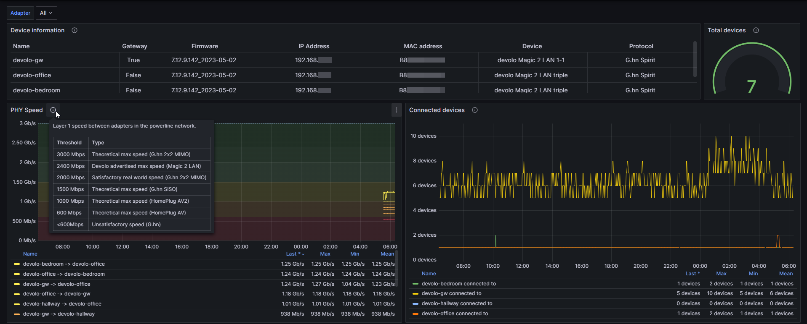

# Prometheus Devolo Exporter

A simple Devolo Magic 2 LAN G.hn adapter metrics exporter for Prometheus based on [devolo-plc-api](https://github.com/2Fake/devolo_plc_api).

This exporter does not support the WiFi metrics for Devolo products as I do not own any; feel free to create a pull request if you want to add support for them.

This code is insipired by [fsck-block/arris-tg3442de-exporter](https://github.com/fsck-block/arris-tg3442de-exporter), as it was a good starting point for Python based exporter to integrate with devolo-plc-api.

## Exported metrics

```
# HELP devolo_device_info_info General device information
# TYPE devolo_device_info_info gauge
devolo_device_info_info{attached_to_gateway="True",friendly_version="7.12.9.142_2023-05-02",full_version="magic-2-lan-triple 7.12.9.142_2023-05-02",hostname="devolo-hostname",ip_address="123.123.123.123",ipv4_address="123.123.123.123",mac_address="CAFEBABE2023",network_name="custom-network",product_id="MT3159",product_name="devolo Magic 2 LAN triple",technology="G.hn Spirit",topology="local"} 1.0
devolo_device_info_info{attached_to_gateway="False",friendly_version="7.12.9.142_2023-05-02",full_version="magic-2-lan 7.12.9.142_2023-05-02",hostname="devolo-hostname2",ip_address="123.123.123.124",ipv4_address="123.123.123.124",mac_address="CAFEBABE2022",network_name="custom-network",product_id="MT3007",product_name="devolo Magic 2 LAN 1-1",technology="G.hn Spirit",topology="remote"} 1.0
# HELP devolo_connected_devices_amount Number of connected devices
# TYPE devolo_connected_devices_amount gauge
devolo_connected_devices_amount{hostname="devolo-hostname",ip_address="123.123.123.123",network_name="custom-network"} 3.0
devolo_connected_devices_amount{hostname="devolo-hostname2",ip_address="123.123.123.124",network_name="custom-network"} 1.0
# HELP devolo_uptime Device uptime (unitless, strictly monotonically increasing; a decrease indicates a restart)
# TYPE devolo_uptime gauge
devolo_uptime{hostname="devolo-hostname",ip_address="123.123.123.123",network_name="custom-network"} 123456.0
devolo_uptime{hostname="devolo-hostname2",ip_address="123.123.123.124",network_name="custom-network"} 123400.0
# HELP devolo_temperature_celsius Temperature of the PLC chip
# TYPE devolo_temperature_celsius gauge
devolo_temperature_celsius{hostname="devolo-hostname",ip_address="123.123.123.123",network_name="custom-network"} 70.9
devolo_temperature_celsius{hostname="devolo-hostname2",ip_address="123.123.123.124",network_name="custom-network"} 65.2
# HELP devolo_hops Number of hops to the domain master (0 = master, 1 = direct, >1 = relayed)
# TYPE devolo_hops gauge
devolo_hops{hostname="devolo-hostname",ip_address="123.123.123.123",network_name="custom-network"} 0.0
devolo_hops{hostname="devolo-hostname2",ip_address="123.123.123.124",network_name="custom-network"} 1.0
# HELP devolo_lost_maps_total Media access plans lost since the last device start
# TYPE devolo_lost_maps_total counter
devolo_lost_maps_total{hostname="devolo-hostname",ip_address="123.123.123.123",network_name="custom-network"} 0.0
devolo_lost_maps_total{hostname="devolo-hostname2",ip_address="123.123.123.124",network_name="custom-network"} 178.0
# HELP devolo_tx_rate_megabits Device tx rate
# TYPE devolo_tx_rate_megabits gauge
devolo_tx_rate_megabits{from_hostname="devolo-hostname",from_ip_address="123.123.123.123",network_name="custom-network",to_hostname="devolo-hostname2",to_ip_address="123.123.123.124"} 796.0
devolo_tx_rate_megabits{from_hostname="devolo-hostname2",from_ip_address="123.123.123.124",network_name="custom-network",to_hostname="devolo-hostname",to_ip_address="123.123.123.123"} 1249.0
# HELP devolo_rx_rate_megabits Device rx rate
# TYPE devolo_rx_rate_megabits gauge
devolo_rx_rate_megabits{from_hostname="devolo-hostname",from_ip_address="123.123.123.123",network_name="custom-network",to_hostname="devolo-hostname2",to_ip_address="123.123.123.124"} 837.0
devolo_rx_rate_megabits{from_hostname="devolo-hostname2",from_ip_address="123.123.123.124",network_name="custom-network",to_hostname="devolo-hostname",to_ip_address="123.123.123.123"} 1249.0
```

The uptime, temperature, hops and lost maps metrics are read directly from each adapter's own IP address, using the configured password for every adapter. Adapters that cannot be reached, or values the firmware does not report, are skipped.

## Usage

The password is the one you have set for the Devolo device.

```
Usage:
  python3 run.py config.yml [OPTIONS]

Application Options:
  -d, --debug Show debug messages (default: false)
```

### Docker Compose

```yaml
---
version: '3.7'
services:
  devolo-exporter:
    image: tssge/prometheus-devolo-exporter:latest
    container_name: DevoloExporter
    volumes:
      - ./config.yml:/app/config.yml
    ports:
      - 5642:5642
```

### Manual run

```bash
python3 -m venv venv
venv/bin/pip3 install -r requirements.txt
venv/bin/python3 run.py config.yml
```

## Grafana dashboard

There is a Grafana dashboard available at [https://grafana.com/grafana/dashboards/19847-ethernet-over-powerline/](https://grafana.com/grafana/dashboards/19847-ethernet-over-powerline/).

### Dashboard features

- Basic information of each device
- PHY datarates between each adapter in the network
- Amount of devices connected to each adapter and total
- Ability to view multiple adapter's statistics simultaneously

